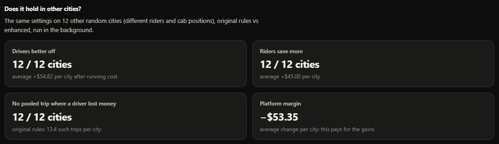

<h1 align="center">PoolSim</h1>

<b>Uber Pool that's fair to drivers and riders.</b> 
One city, three rule books, played side by side.

<i>252 seconds in, same riders and same bomb threat. Riders still waiting: 
<b>21</b> enhanced, <b>25</b> original, <b>35</b> without pooling.</i>

Open `index.html` and press Start.

## The flaw

Drivers were paid per second with someone aboard, so seconds with two riders counted once. Pooling paid them less:

That hit 63% of pooled trips. Riders got 30% off even when nobody joined, and cabs drove fixed L-shaped routes.

## Six fixes

1. **Paid per rider.** A pooled trip pays at least what the solo trips would have, so taking a second rider never
   costs the driver.
2. **A premium that learns.** The two-rider bonus resets to break-even after every pooled trip, instead of a fixed
   25% that is right in one city and wrong in the next.
3. **Sharing rewarded.** 35% off if you shared, 25% if nobody joined: the discount pays for sharing, not for ticking
   a box.
4. **Pool-first matching.** Riders join a cab already pooling unless it's 20+ seconds worse, which keeps empty cabs
   free for the next request.
5. **Pickup cover.** The drive to a pickup is unpaid but burns fuel; the platform covers any trip that runs at a
   loss, so no driver ends below zero.
6. **Fastest routes.** Dijkstra over real street costs, so cabs do their north-south driving on the fast side and
   find the shortest way around a cordon.

The city is harder too, for every model: the right half is 25% slower (congestion), and bomb threats close a
cordon at random. Riders inside walk to its edge, and drivers are paid for the detour.

## See it

- **Maps:** enhanced cabs dodge the slow side and carry more orange two-rider trips.
- **Tiles:** "Pooled trips where the driver lost money" stays at 0. Green means better than the original.
- **Fuel slider at 0.30:** drivers below zero drop from 5 to 0.
- **Report:** before and after, the bomb's effect, and a replay on 12 other cities:

## The numbers

16 random cities, 30 cabs, original → enhanced (`node test/compare.js`):

- Driver-losing pooled trips: **12.7 → 0** per run.
- Drivers **+$53**, riders **+$45** per run.
- Riders who share: **65% → 69%** (30% → 47% with 60 cabs).
- Waits and rides: slightly better. The platform funds it: margin about 19% lower.

## The algorithms

- **Dijkstra, run backwards** from each destination with a binary heap, cached per road state (`dijkstraTo`).
- **Constrained insertion:** every pickup and drop-off slot is tried and every rider's limits checked (`bestInsertion`).
- **Per-trip settlement** of the pay floor and pickup cover (`closeTrip`, `closeJob`).

`node test/sim.test.js` runs 28 tests, including: everything off reproduces the original exactly, and Dijkstra
matches brute force.

## Assumptions

- No traffic beyond the slow right half; demand is spread evenly, as in the original.
- Every driver accepts every request offered; a rider's choice to opt in doesn't react to price.
- The platform, not riders, pays the driver protections (fixes 1 and 5).
