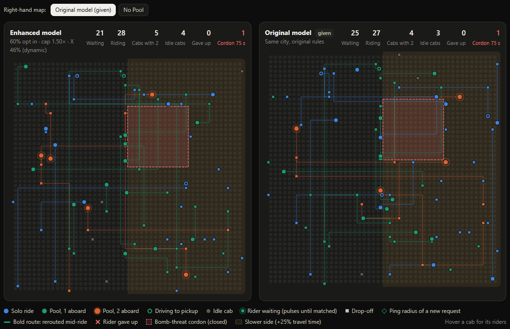
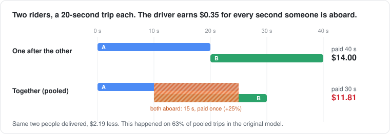

<h1 align="center">PoolSim</h1>

<b>Uber Pool that's fair to drivers and riders.</b> 
One city, three rule books, played side by side.

<i>252 seconds in. Same riders, same cabs, same bomb threat. 
Riders still waiting: <b>21</b> in the enhanced model, <b>25</b> in the original, <b>35</b> without pooling.</i>

Open `index.html` and press Start.

## The flaw I found

In the original prototype a driver is paid per second with someone aboard, and seconds with two riders count once.
So carrying two people together can pay less than carrying them one after the other:

On top of that, every rider who opted in got 30% off even if nobody joined, and cabs always drove an L-shaped route,
even straight through the slowest part of town.

## What I changed

Six enhancements, in the sidebar under **Enhancements**. "Original rules" and "All enhancements" flip them at once.

1. **Drivers paid per rider.** A pooled trip pays at least what the riders' solo trips would have.
2. **A premium that learns.** The extra pay for two riders resets after every pooled trip to the break-even value.
3. **Sharing rewarded.** 35% off if you actually shared, 25% if nobody joined (was 30% for everyone).
4. **Pool-first matching.** A pool rider joins a cab already on a pool trip unless that's 20+ seconds worse.
5. **Pickup cover.** If a trip costs the driver more in fuel than it pays, the platform covers it.
6. **Fastest routes.** Dijkstra over the real street costs, instead of the fixed L-shaped route.

I also made the city harder, equally for every model:

- **The right side is slow.** Every street on the right half takes 25% longer (shaded on the maps).
- **Bomb threats.** A cordon closes at random for 90 s, at least once per run. Cabs route around it, riders inside
  walk to its edge, and drivers are paid for the empty detour.

## What to watch

- **The three maps.** Enhanced cabs bend left to avoid the slow side and carry more orange two-rider trips; the
  original cabs drive straight through.
- **The two rows of tiles.** One compares the enhanced model with No Pool, the other with the original model. Green
  means better. Start with "Pooled trips where the driver lost money": the enhanced model stays at 0.
- **X in the first map's header.** It climbs from 25% to about 45% as it learns.
- **The fuel slider.** Set "Driver running cost" to 0.30 and drivers below zero drop from 5 to 0.
- **The report.** It opens at the end with the full before and after, what the bomb did (on the default city, 10
  riders delayed and 27 s of delay added), and your settings replayed on 12 other cities:

## The numbers

Across 16 random cities, default settings, 30 cabs, original against enhanced:

- Pooled trips where the driver lost money: **12.7 per run → 0**.
- Drivers earn **$53 more** per run, ahead in 15 of 16 cities.
- Riders save **$45 more** per run, ahead in all 16.
- Riders who actually share: **65% → 69%** (30% → 47% with 60 cabs).
- Waits a little shorter (21.9 s → 21.4 s), a few more rides completed (149.0 → 150.7).
- The cost: the platform's margin is about 19% lower. That money is what pays drivers and riders.

`node test/compare.js` reproduces these.

## Under the hood

- `js/sim.js`: the rules (`closeTrip`, `closeJob`, `matchQueue`), the roads (`dijkstraTo`, `dist`, `nextStep`) and
  the bombs (`startThreat`).
- `js/metrics.js`, `js/report.js`: the before and after, the bomb effect and the 12-city check.
- `js/app.js`: controls, presets and the three-way comparison. `js/render.js`: the slow side and the cordons.
- `node test/sim.test.js` runs 28 tests. Two worth knowing: with every enhancement off and the city made uniform, the
  engine reproduces the original prototype exactly; and Dijkstra matches a brute-force search on every corner.
